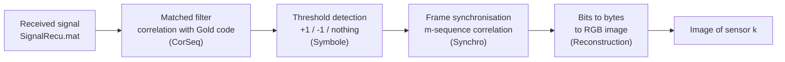

# CDMA Demodulation of Sensor Data with Gold Sequences (MATLAB)

Signal processing project for **wireless sensor networks**: two sensors (*capteurs*) transmit **at the same time on the same channel**. Each one spreads its data with its own **Gold sequence** (CDMA). The receiver gets one mixed signal and has to separate the two transmissions, recover the bits, and rebuild what each sensor sent.

Each sensor sends an **image**. After demodulation we get:

| Sensor | Recovered image |
|--------|-----------------|
| Sensor 1 |  |
| Sensor 2 |  |

> Put your output images in an `images/` folder (save them from the MATLAB figures) and adjust the file names / captions above if sensor 1 and 2 are the other way round.

### Easy case (`facile.m`)

The simplified version uses a separate received signal (`SignalRecu_facile.mat`) with a **single sensor** and no multi-user interference. Its output is a different image: **a cloud in a blue sky**.

| Single sensor (easy case) |
|---------------------------|
|  |

---

## Table of contents

1. [Principle](#principle)
2. [Processing pipeline](#processing-pipeline)
3. [Repository structure](#repository-structure)
4. [How each step works](#how-each-step-works)
5. [Usage](#usage)
6. [Requirements](#requirements)
7. [Parameters](#parameters)

---

## Principle

**CDMA (Code Division Multiple Access)** lets several users share the same frequency band and time slots. Every user multiplies each data bit by a long pseudo-random code (the *spreading code*). The receiver correlates the incoming signal with the code of the user it wants: that user's bits show up as strong correlation peaks, while the other users look like low-level noise.

Here the spreading codes are **Gold sequences**, built from two **m-sequences** (maximal-length LFSR sequences). Gold codes are used because:

- they are easy to generate (XOR of two m-sequences with a relative shift),
- a large family of codes comes from just one pair of polynomials (one code per shift `d`),
- their cross-correlation is low and bounded, so users interfere little with each other,
- their autocorrelation has a sharp peak (equal to the code length), which allows detection and synchronisation.

## Processing pipeline



The chain is run twice on the same received signal: once with the Gold code of sensor 1, once with the Gold code of sensor 2.

## Repository structure

```
.
├── projet.m              # Main script: full 2-sensor CDMA demodulation
├── facile.m              # "Easy" version: single sensor, no multi-user interference
├── msequence.m           # m-sequence generator (LFSR)
├── Gold.m                # Gold code generator
├── CorSeq.m              # Correlation of the received signal with a code
├── Symbole.m             # Threshold decision -> symbols +1 / -1
├── Synchro.m             # Frame synchronisation with an m-sequence
├── Reconstruction.m      # Symbols -> bits -> bytes -> RGB image
├── SignalRecu.mat        # Received signal (2 sensors, CDMA)
├── SignalRecu_facile.mat # Received signal (easy case)
└── images/               # Result images
```

## How each step works

### 1. m-sequences: `msequence.m`

Generates a maximal-length sequence of length `L = 2^m - 1` using a linear feedback shift register defined by a polynomial `p` (degree `m`). It returns the sequence both in binary `{0,1}` and in bipolar `{-1,+1}` form.

Three polynomials are used in `projet.m`:

| Polynomial | Degree | Sequence length | Role |
|------------|--------|-----------------|------|
| `p1 = [1 1 0 0 0 0 1]` | 6 | 63 | first m-sequence `a` (to build Gold codes) |
| `p2 = [1 1 1 0 0 1 1]` | 6 | 63 | second m-sequence `b` (to build Gold codes) |
| `p3 = [1 0 0 0 1 0 0 1]` | 7 | 127 | synchronisation sequence `c` (frame delimiter) |

### 2. Gold codes: `Gold.m`

A Gold code is the XOR of the first m-sequence with a **circularly shifted** copy of the second one:

```
gold_d = a  XOR  shift(b, d)
```

Changing the shift `d` gives a different code of the same family. Each sensor has its own:

- Sensor 1: `Gold(A, B, 1)`
- Sensor 2: `Gold(A, B, 2)`

Both codes have length 63, so each data bit is spread over **63 chips**.

### 3. Despreading: `CorSeq.m`

The received signal is filtered with the time-reversed code (a **matched filter**), which is the same as a sliding correlation:

```matlab
cor = filter(code(end:-1:1), 1, SignalRecu);
```

When the code is aligned with a transmitted bit, the output reaches about **±63** (the code length). The sign gives the bit value. Elsewhere, and for the other sensor's code, the correlation stays small. The histogram of `|cor|` makes the threshold choice easy: two clusters are visible, the noise/interference floor and the peaks.

### 4. Symbol decision: `Symbole.m`

Using a threshold (`60` in `projet.m`):

- `cor > +threshold` → symbol `+1`
- `cor < -threshold` → symbol `-1`
- anything in between is discarded

Only the detected peaks remain, which gives the stream of symbols sent by that sensor.

### 5. Frame synchronisation: `Synchro.m`

The transmitted stream contains a known **m-sequence of length 127** (`p3`) used as a marker. The symbol stream is correlated with it:

```matlab
syn = filter(c(end:-1:1), 1, symbole);
t   = find(abs(syn) == max(abs(syn)));
```

The sequence appears twice, and the two maxima in `t` mark where the useful payload **starts and ends**. The `stem` plot of `|syn|` shows these two peaks clearly.

### 6. Image reconstruction: `Reconstruction.m`

1. Take the symbols between the two sync markers.
2. Map `+1 → 0` and `-1 → 1`.
3. Group the bits into **8-bit bytes** (`bit2int`).
4. The **first byte** is the number of image rows.
5. The remaining bytes are the pixel values, stored as three consecutive planes: **R, G, B**. The number of columns is deduced from the amount of data.
6. Each plane is reshaped to `rows × cols` and divided by 255 to get an image in `[0, 1]`.

## Usage

1. Clone the repository and open the folder in MATLAB.
2. Run the main script:

   ```matlab
   projet
   ```

3. The script produces:
   - the histograms of the correlation magnitude for each sensor (to choose the threshold),
   - the synchronisation peaks (`stem` plots) for each sensor,
   - **two figures with the recovered images** (cloudy sky and thunderstorm).

To try the simplified single-sensor case, run `facile` instead (it uses `SignalRecu_facile.mat`). It uses the m-sequence `a` directly as the spreading code, a detection threshold `seuil = 0.95 * length(a)` (about 60 for a 63-chip code), and recovers one image: a cloud in a blue sky.

## Requirements

- MATLAB (a recent version)
- **Communications Toolbox** (`bit2int`)
- **Image Processing Toolbox** (`imshow`)

## Parameters

| Parameter | Value | Where |
|-----------|-------|-------|
| Gold code length | 63 chips | `Gold.m` / `msequence.m` |
| Gold shifts | `d = 1` (sensor 1), `d = 2` (sensor 2) | `projet.m` |
| Detection threshold (2 sensors) | 60 | `projet.m` (`Symbole(..., 60)`) |
| Detection threshold (easy case) | `0.95 * length(a)` (about 60) | `facile.m` (`seuil`) |
| Sync sequence length | 127 | polynomial `p3` |
| Bits per pixel value | 8 | `Reconstruction.m` |
| Image format | RGB, 3 planes, row count in first byte | `Reconstruction.m` |

---

## Author

Youcef Talbi: Master 2 Networks and Telecommunications, Université Gustave Eiffel.
